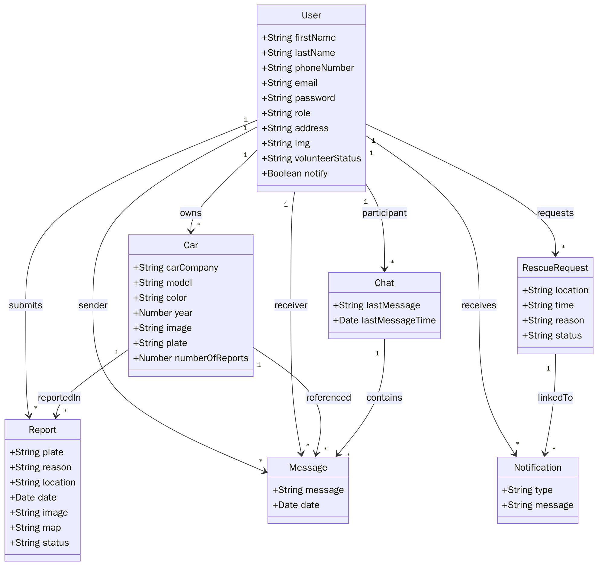

# Plate&Go — Driver Help & Roadside Rescue (Front End)

Plate&Go helps drivers solve everyday car problems through the license plate. Find any car by its plate number, let the owner know about a problem (your car is blocked, their lights are on, a child was left inside), talk to them in real time by chat or voice call, and ask nearby volunteers for roadside help.

This repository contains the **front end**, written in HTML, CSS and vanilla JavaScript. The complete project, front end and Node.js back end, is in the team repository **[karammhajne/platego](https://github.com/karammhajne/platego)**.

---

## Features

- **Accounts.** Sign up and log in; the session is kept with a JSON Web Token.
- **My Cars.** Add, edit and remove your cars (make, model, year, color, image and plate).
- **Car Finder.** Look up any car by its license plate and open its details page.
- **Reports to the owner.** Choose a reason (car blocking, lights left on, child left inside, mechanical issue) and a location; the address is converted to coordinates with OpenStreetMap Nominatim and shown on a Leaflet map. Every report keeps a history and a details page.
- **Real-time notifications.** Reports, messages and rescue updates arrive instantly over Socket.IO, and stored notifications can be marked as read.
- **Chat.** One-to-one conversations with live updates and image attachments; the chat list always shows the latest message.
- **Voice calls.** In-browser calls between drivers with WebRTC, using Socket.IO for signaling (call, accept, reject, end).
- **Rescue Me.** Ask for help with a flat tire, an engine problem, an empty tank or an accident. The request is sent live to every available volunteer, and the volunteer who accepts is connected to the driver in a chat automatically.
- **Volunteers.** Any user can become a volunteer and switch their availability on or off.

## Tech stack

| Part | Technologies |
| --- | --- |
| Front end (this repo) | HTML5, CSS3 (responsive, media queries), vanilla JavaScript (ES6+), Leaflet, Socket.IO client, WebRTC |
| Back end ([team repo](https://github.com/karammhajne/platego)) | Node.js, Express, MongoDB with Mongoose, Socket.IO, JSON Web Tokens, bcrypt |
| Hosting | Back end on Render |

## Pages

| Page | File |
| --- | --- |
| Log in / Sign up | `index.html`, `signup.html` |
| Home with map | `home-page.html` |
| Car Finder and car details | `car-finder.html`, `car-details.html` |
| My Cars | `my-cars.html` |
| Report history and details | `report_history.html`, `report_detail.html` |
| Notifications | `notifications.html` |
| Chats and messages | `chat-list.html`, `chat.html`, `messages.html` |
| Rescue Me | `rescue-me.html` |
| Edit profile | `edit-profile.html` |

## Running locally

1. **Start the back end** from the [team repository](https://github.com/karammhajne/platego):

   ```bash
   git clone https://github.com/karammhajne/platego.git
   cd platego/backend
   npm install
   ```

   Create `backend/.env`:

   ```env
   MONGO_URI=<your MongoDB connection string>
   JWT_SECRET=<any long random string>
   PORT=3000
   ```

   Then run `node server.js`.

2. **Point this front end at the back end** in `js/config.js`:

   ```js
   const BACKEND_URL = "http://localhost:3000";
   ```

3. **Serve this folder** with any static server, for example the VS Code Live Server extension or `npx serve .`, and open `index.html`.

## Data model



## Team

Plate&Go was built by a team of three: **Atheer Azaizeh**, **[Karam Mhajne](https://github.com/karammhajne)** and **Mohamed Egbaria**.

**My part (Atheer):** most of the client side (the pages, styling and client logic in this repository) and the real-time layer on both client and server: Socket.IO chat and notifications, and WebRTC voice calls with Socket.IO signaling.
